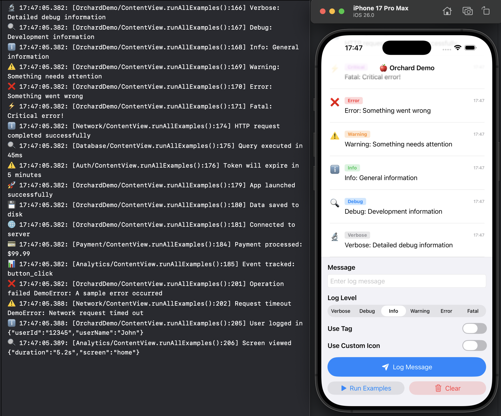

# Orchard

[](https://github.com/kibotu/Orchard/actions/workflows/build-swift.yml)
[](https://github.com/kibotu/Orchard/releases)


Small, tag-and-icon-friendly logging for Swift. Log once; send it to as many places as you like.

```swift
Orchard.loggers.append(ConsoleLogger())

Orchard.tag("Payment").icon("💳").i("Charged", ["amount": "99.99"])
// 💳 13:54:48.403: [Payment/Checkout.pay():42] Charged {"amount":"99.99"}
```

## The problem

`print` is fine for five minutes. Then you want levels, you want to know *where* a line came from, you want errors and context attached, and you want some of it in a crash reporter too. Every app ends up with a hand-rolled wrapper.

Apple's `os.Logger` is excellent for the unified logging system, but it is one destination. If you also want a file, Crashlytics, or your analytics pipeline, you call each of them separately at every call site.

Orchard is the thin layer in between: **one call, any number of destinations**.

**Orchard is a good fit when you want:**
- the same readable line, with file, function, and line, in every log
- message, error, and key-value context in a single call
- tags and icons chosen per call, not per logger
- to add or swap destinations without touching call sites

**Stick with `os.Logger` alone when** you only need Apple's unified logging, with its privacy redaction, compile-time optimizations, and Console.app and Instruments integration. Orchard doesn't replace those; see the [full comparison](comparision-to-other-loggers.md).

You can have both: write a tiny `Orchard.Logger` that forwards to `os.Logger`.

## Key features

- 🎯 **Six log levels**: verbose, debug, info, warning, error, and fatal
- 🔌 **Multiple logging backends**: console, file, remote, crash reporter; anything you can write as a `Logger`
- 🏷️ **Tags**: categorize logs by module, feature, or context
- 🎨 **Custom icons**: visual indicators for different kinds of logs
- 📍 **Automatic call-site tracking**: file, function, and line, no boilerplate
- ⏰ **Timestamps**: optional, with a configurable format
- 🔄 **Flexible parameters**: any combination of message, error, and arguments
- 🧱 **Structured arguments**: key-value context rendered as JSON; values that JSON can't represent fall back to their description instead of crashing
- 🧵 **Thread-safe tag and icon state**
- 📦 **Foundation only**: no dependencies

## Get started

**1. Add the package**

```swift
.package(url: "https://github.com/kibotu/Orchard", from: "<latest-version>")
```

Or in Xcode: **File → Add Package Dependencies…** → `https://github.com/kibotu/Orchard`.

**2. Register a logger once, at launch**

```swift
import Orchard

Orchard.loggers.append(ConsoleLogger())
```

**3. Log**

```swift
Orchard.i("App started")
Orchard.e("Failed to load", error)
Orchard.i("Tapped", ["button": "submit"])
```

That's it. Foundation only, no other dependencies. Requires iOS 15, macOS 12, tvOS 15, watchOS 8 or visionOS 1, and a Swift 6 toolchain.

[](Examples/)

## Usage guide

### 1. Automatic call-site tracking

Never wonder where a log came from again. Orchard automatically captures file, function, and line:

```swift
Orchard.i("User logged in")
// Output: ℹ️ 13:54:48.403: [OrchardDemo/ContentView.runAllExamples():168] User logged in
//                           ^ module ^^  ^^ file ^^ ^^^ function ^^^  ^^ line number ^^^^^^ message
```

Toggle invocation details on/off:
```swift
let logger = ConsoleLogger()
logger.showInvocation = true   // Shows full path: /Module/function():line
logger.showInvocation = false  // Shows only module name
```

### 2. Maximum flexibility

Mix and match any combination of message, error, and arguments:

```swift
// Message only
Orchard.i("App started")

// Error only
Orchard.e(error)

// Message + Error
Orchard.e("Failed to load data", error)

// Message + Arguments
Orchard.i("User action", ["action": "tap", "button": "submit"])

// Error + Arguments
Orchard.e(error, ["context": "startup", "retry": "false"])

// Message + Error + Arguments
Orchard.e("Request failed", error, ["url": "api.example.com", "method": "POST"])

// Everything: tag, icon, message, error, and arguments
Orchard.tag("API").icon("🔥").e("Critical failure", error, ["endpoint": "/users", "status": "500", "retry": "3"])
```

### 3. Multiple loggers

Log to multiple destinations simultaneously:

```swift
// Send logs to console, file, and remote server at once
Orchard.loggers.append(ConsoleLogger())
Orchard.loggers.append(FileLogger())
Orchard.loggers.append(RemoteLogger())

// Every log call reaches all registered loggers
Orchard.i("User logged in")
// → Appears in console
// → Written to log file
// → Sent to analytics server
```

### 4. Console logger configuration

Customize what information appears in your logs:

```swift
let consoleLogger = ConsoleLogger()

// Enable/disable timestamps
consoleLogger.showTimesStamp = true  // Shows: 13:54:48.402:

// Enable/disable invocation details
consoleLogger.showInvocation = true  // Shows: /Filename.function:line

Orchard.loggers.append(consoleLogger)
```

#### Advanced Configuration with ConsoleLoggerConfig

For more control, use `ConsoleLoggerConfig` to customize timestamp format and module name mapping.

**Option 1: Builder-style configuration (recommended)**

```swift
let consoleLogger = ConsoleLogger { config in
    config.showTimestamp = true
    config.timestampFormat = "yyyy-MM-dd HH:mm:ss.SSS"  // Custom date format
    config.showInvocation = true
    config.moduleNameMapper = { moduleName in
        // Custom module name transformation
        // The mapper receives the extracted module name and can transform it
        return moduleName.replacingOccurrences(of: "OrchardDemo", with: "Demo")
    }
}
Orchard.loggers.append(consoleLogger)
```

**Option 2: Config struct initialization**

```swift
let config = ConsoleLoggerConfig(
    showTimestamp: true,
    timestampFormat: "yyyy-MM-dd HH:mm:ss.SSS",  // Custom date format
    showInvocation: true,
    moduleNameMapper: { moduleName in
        // Custom module name transformation
        return moduleName.components(separatedBy: "/").last ?? moduleName
    }
)

let consoleLogger = ConsoleLogger(config: config)
Orchard.loggers.append(consoleLogger)
```

**Option 3: Modify config after initialization**

```swift
let consoleLogger = ConsoleLogger()
consoleLogger.config.timestampFormat = "HH:mm:ss"
consoleLogger.config.moduleNameMapper = { moduleName in
    return "[\(moduleName.uppercased())]"
}
Orchard.loggers.append(consoleLogger)
```

**Configuration Options:**
- `showTimestamp`: Enable/disable timestamps (default: `true`)
- `timestampFormat`: DateFormatter format string (default: `"HH:mm:ss.SSS"`)
- `showInvocation`: Show file/function/line details (default: `true`)
- `moduleNameMapper`: Transform module names with a custom closure (default: `nil`)
  - The closure receives the module name taken from `#fileID`
  - Return the transformed module name to display in logs

**Example with custom module name mapper:**
```swift
// Shorten module names: "MyApp/ViewModels/UserViewModel" → "UserViewModel"
let logger = ConsoleLogger { config in
    config.moduleNameMapper = { moduleName in
        return moduleName.components(separatedBy: "/").last ?? moduleName
    }
}
Orchard.loggers.append(logger)

Orchard.i("User logged in")
// Output: ℹ️ 13:54:48.403: [UserViewModel/login:42] User logged in
```

### 5. Tags and icons

The killer feature: combine tags and custom icons for instantly recognizable, categorized logs:

```swift
// Payment processing
Orchard.tag("Payment").icon("💳").i("Payment processed: $99.99")
// Output: 💳 13:54:48.403: [Payment/ContentView.runAllExamples():184] Payment processed: $99.99

// Analytics tracking
Orchard.tag("Analytics").icon("📊").d("Event tracked: button_click")
// Output: 📊 13:54:48.403: [Analytics/ContentView.runAllExamples():185] Event tracked: button_click

// Network monitoring
Orchard.tag("Network").icon("🌐").i("Connected to server")
// Output: 🌐 13:54:48.403: [Network/ContentView.runAllExamples():181] Connected to server
```

### 6. Rich error logging

Log errors with full context - message, error object, and metadata in one call:

```swift
enum NetworkError: Error, CustomStringConvertible {
    case timeout
    case connectionFailed(reason: String)
    
    var description: String {
        switch self {
        case .timeout:
            return "NetworkError: Request timed out"
        case .connectionFailed(let reason):
            return "NetworkError: Connection failed - \(reason)"
        }
    }
}

// Message with error
Orchard.e("Operation failed", NetworkError.connectionFailed(reason: "Host unreachable"))
// Output: ❌ 13:54:48.403: [OrchardDemo/ContentView.runAllExamples():201] Operation failed NetworkError: Connection failed - Host unreachable

// Full context: tag, icon, message, and error
Orchard.tag("Network").icon("⚠️").e("Request timeout", NetworkError.timeout)
// Output: ⚠️ 13:54:48.413: [Network/ContentView.runAllExamples():202] Request timeout NetworkError: Request timed out

// Add metadata for debugging
Orchard.tag("API").icon("🔥").e("Request failed", NetworkError.timeout, ["endpoint": "/users", "retry": "3"])
// Output: 🔥 13:54:48.413: [API/ContentView.runAllExamples():203] Request failed NetworkError: Request timed out {"endpoint":"/users","retry":"3"}
```

### 7. Structured arguments

Attach key-value pairs for rich, queryable logs - perfect for analytics and debugging:

```swift
// User events
Orchard.i("User logged in", ["userId": "12345", "userName": "John", "method": "oauth"])
// Output: ℹ️ 13:54:48.413: [OrchardDemo/ContentView.runAllExamples():205] User logged in {"userId":"12345","userName":"John","method":"oauth"}

// Performance metrics
Orchard.tag("Performance").d("API response", ["duration": "245ms", "endpoint": "/api/users", "status": "200"])
// Output: 🔍 13:54:48.413: [Performance/ContentView.runAllExamples():206] API response {"duration":"245ms","endpoint":"/api/users","status":"200"}

// Error context
Orchard.tag("Database").e("Query failed", error, ["query": "SELECT * FROM users", "retry": "false"])
```

### 8. Six log levels

Professional logging with built-in visual hierarchy:

```swift
Orchard.v("Verbose: Detailed debug information")
// Output: 🔬 13:54:48.402: [OrchardDemo/ContentView.runAllExamples():166] Verbose: Detailed debug information

Orchard.d("Debug: Development information")
// Output: 🔍 13:54:48.403: [OrchardDemo/ContentView.runAllExamples():167] Debug: Development information

Orchard.i("Info: General information")
// Output: ℹ️ 13:54:48.403: [OrchardDemo/ContentView.runAllExamples():168] Info: General information

Orchard.w("Warning: Something needs attention")
// Output: ⚠️ 13:54:48.403: [OrchardDemo/ContentView.runAllExamples():169] Warning: Something needs attention

Orchard.e("Error: Something went wrong")
// Output: ❌ 13:54:48.403: [OrchardDemo/ContentView.runAllExamples():170] Error: Something went wrong

Orchard.f("Fatal: Critical error!")
// Output: ⚡️ 13:54:48.403: [OrchardDemo/ContentView.runAllExamples():171] Fatal: Critical error!
```

### 9. Tags for organization

Categorize logs by module, feature, or any context you need:

```swift
// Network operations
Orchard.tag("Network").i("HTTP request completed successfully")
// Output: ℹ️ 13:54:48.403: [Network/ContentView.runAllExamples():174] HTTP request completed successfully

// Database operations
Orchard.tag("Database").d("Query executed in 45ms")
// Output: 🔍 13:54:48.403: [Database/ContentView.runAllExamples():175] Query executed in 45ms

// Authentication
Orchard.tag("Auth").w("Token will expire in 5 minutes")
// Output: ⚠️ 13:54:48.403: [Auth/ContentView.runAllExamples():176] Token will expire in 5 minutes
```

### 10. Custom icons

Override default level icons for visual categorization:

```swift
Orchard.icon("🚀").i("App launched successfully")
// Output: 🚀 13:54:48.403: [OrchardDemo/ContentView.runAllExamples():179] App launched successfully

Orchard.icon("💾").d("Data saved to disk")
// Output: 💾 13:54:48.403: [OrchardDemo/ContentView.runAllExamples():180] Data saved to disk

Orchard.icon("🔐").w("Certificate will expire soon")
// Output: 🔐 13:54:48.403: [OrchardDemo/ContentView.runAllExamples():181] Certificate will expire soon
```

### 11. Writing your own logger

Conform to `Orchard.Logger`. `level` is the minimum severity the logger cares about:

```swift
final class CrashReportLogger: Orchard.Logger {
    let level: Orchard.Level = .error
    var tag: String?
    var icon: Character?

    func verbose(_ message: String?, _ error: Error?, _ args: [String: CustomStringConvertible]?, _ file: String, _ fileId: String, _ function: String, _ line: Int) {}
    func debug(_ message: String?, _ error: Error?, _ args: [String: CustomStringConvertible]?, _ file: String, _ fileId: String, _ function: String, _ line: Int) {}
    func info(_ message: String?, _ error: Error?, _ args: [String: CustomStringConvertible]?, _ file: String, _ fileId: String, _ function: String, _ line: Int) {}
    func warning(_ message: String?, _ error: Error?, _ args: [String: CustomStringConvertible]?, _ file: String, _ fileId: String, _ function: String, _ line: Int) {}

    func error(_ message: String?, _ error: Error?, _ args: [String: CustomStringConvertible]?, _ file: String, _ fileId: String, _ function: String, _ line: Int) {
        // forward to your crash reporter
    }

    func fatal(_ message: String?, _ error: Error?, _ args: [String: CustomStringConvertible]?, _ file: String, _ fileId: String, _ function: String, _ line: Int) {
        self.error(message, error, args, file, fileId, function, line)
    }
}
```

For tests, `Orchard.loggers` is a plain array: swap in a recording logger and assert on what it received.

## Good to know

- Add loggers at startup. `Orchard.loggers` is a plain array and is not synchronized, so avoid mutating it while other threads are logging.
- A tag or icon is shared state until the next log call consumes it. Chain it directly onto the call, as in the examples above.
- Logs are not redacted. Keep secrets and personal data out of messages and arguments.

## More

- [Demo app](Examples/): open `Examples/OrchardDemo` and press **⌘R**.
- [How Orchard compares to other loggers](comparision-to-other-loggers.md).

Contributions are welcome. Please run `swift test` and `swiftlint` before opening a pull request.

### License
<pre>
Copyright 2024 Jan Rabe & CHECK24

Licensed under the Apache License, Version 2.0 (the "License");
you may not use this file except in compliance with the License.
You may obtain a copy of the License at

   http://www.apache.org/licenses/LICENSE-2.0

Unless required by applicable law or agreed to in writing, software
distributed under the License is distributed on an "AS IS" BASIS,
WITHOUT WARRANTIES OR CONDITIONS OF ANY KIND, either express or implied.
See the License for the specific language governing permissions and
limitations under the License.
</pre>
